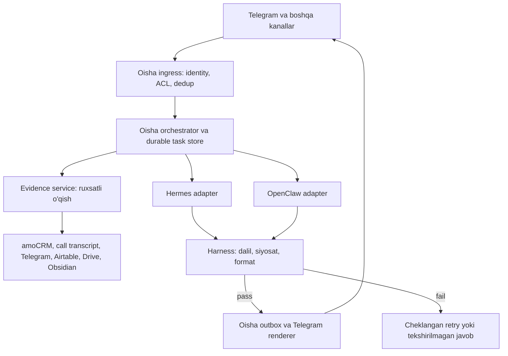

# Oisha + Hermes + OpenClaw + Harness

2026-10-28. Status: taklif etilgan arxitektura; deploy qilinmagan.

## Tekshiruv qamrovi

Lokal checkoutdagi Hermes provider/context/harness, eval runner, OpenClaw bridge va API router, group mention handler, Customer360 query engine o'qildi; integratsiya chaqiruvlari qidirildi. Bu butun repository va productionning to'liq auditi emas. Oldindan mavjud dirty fayllar mavjud; ushbu hujjat ularning live deploy holatini tasdiqlamaydi.

## Koddan aniqlangan muammolar

| Joy | Dalil | Natija |
|---|---|---|
| `src/api/routes/openclaw_gateway.py` va `src/openclaw_bridge.py` | Route positional message va user_id beradi, bridge esa keyword-only text/sender/sender_id/channel/session talab qiladi | Ushbu route chaqiruvi signature bilan mos emas; runtime tasdig'i hali yo'q |
| `src/openclaw_bridge.py` | String ID uchun Python hash ishlatiladi; session argument ishlatilmaydi | ID restartlar orasida o'zgarishi, suhbatlar ajratilishi yo'qolishi mumkin |
| `src/services/core/ai/hermes_provider.py` | CLI stdout regex bilan tozalanadi, nonzero exitda ham javob qaytishi mumkin; timeoutda process kill/wait yo'q | Texnik matn javobga tushishi va osilib qolgan subprocess xavfi |
| Shu provider | Yangi session ID generate_response ichida tashlab yuboriladi; executable mavjudligi availability hisoblanadi | Suhbat davomiyligi va provider tayyorligi tasdiqlanmagan |
| `src/services/core/ai/hermes_harness.py` | Barcha refinement tugaganda sanitize natijasi qayta tekshirilmasdan success bo'ladi | Sifat nazorati muvaffaqiyatsiz javobni o'tkazadi |
| Shu harness | Dollar miqdorini regex bilan taqiqlaydi, manba bilan solishtirmaydi | Haqiqiy narx bloklanishi, uydirma fakt o'tishi mumkin |
| `scripts/harness/evaluate_hermes.py` | expected_invariants ko'p qiymatlari tekshirilmaydi; report mock/live rejimini saqlamaydi | 100% baho real agent sifatini isbotlamaydi |
| `src/services/core/ai/hermes_context.py` | Owner uchrashuvdaligini oldindan buyuradi | Haqiqiy kalendar dalilisiz holat to'qiladi |
| `src/services/customer_360/query_engine.py` | Obsidian karta topilsa live collect chetlab o'tiladi; freshness tekshiruvi yo'q | Eskirgan karta joriy to'lov va'dasiga javob bo'lishi mumkin |
| `src/handlers/group_mention.py` | Javoblar bevosita message.reply orqali chiqadi | Yagona yakuniy sifat/delivery gate yo'q |

## Maqsad tuzilma

Oisha yagona identity, ruxsat, biznes holati va yuborish egasi. Hermes asosiy reasoning worker. OpenClaw alohida adapter bilan aniq delegatsiya qilingan ishlarni bajaradi; parallel ikkinchi Telegram bot consumer bo'lmaydi. OpenClaw'ning amaldagi tashqi versiyasi/protokoli integratsiya implementatsiyasidan oldin tekshiriladi. Ikkala agentni har savolda birga chaqirish shart emas.

Harness ikki vazifaga ajraladi: runtime javobni o'tkazish/bloklash va offline regression baholash. LLM critic maslahat beradi; ruxsat va tashqi amallarni deterministik policy tekshiradi. Promptga yozilgan taqiq o'zi xavfsizlik chegarasi emas.

## Shartnomalar

- Request: request_id, tenant_id, actor_id, channel, chat_id, topic_id, message_id, intent, deadline, allowed_scopes.
- Task: task_id, request_id, agent, status, attempt, budget, idempotency_key, timestamps. Statuslar: queued/running/waiting/verified/delivery_pending/delivered/failed. Verified delivered degani emas.
- Evidence: source, source_record_id, source_url, observed_at, occurred_at, content_hash, excerpt, access_scope, freshness, collection_status. Collection status: complete/partial/unavailable; unavailable hech qachon nol emas.
- AgentResult: answer, claims[{text,evidence_ids}], proposed_actions, missing_sources, model, provider, latency, usage (noma'lum bo'lsa null).
- Verdict: pass/retry/block, reasons, checked_claims, policy_version. Maksimal retry va umumiy vaqt/xarajat limiti bo'ladi.
- Delivery: destination chat/topic, approved payload hash, dedup key, provider message ID, delivery status. Timeoutdan keyin ko'r-ko'rona qayta yuborilmaydi.

## Ma'lumot va ruxsat

Credentiallar faqat connector service'da. Agentlar kerakli task doirasidagi read tool orqali ma'lumot oladi. Rol va chat/topic ACL retrievaldan OLDIN tekshiriladi. Guruh nomi ruxsat dalili bo'lmaydi. Alohida identity jadvali (tenant, channel, external_id) ishlatiladi; Python hash yoki ism bo'yicha avtomatik birlashtirish bo'lmaydi. Noaniq dublikatlar reviewga tushadi.

amoCRM va Airtable operatsion yozuvning asl manbasi; Obsidian SOP va bilim manbasi. Transcript original yozuvga bog'lanadi, AI tahlili esa hosila dalil deb belgilanadi. Qarama-qarshi ma'lumotlar va oxirgi yangilanish vaqtini ko'rsatish zarur. Barcha manbalarni har savolda to'liq promptga yuklash o'rniga intentga mos bounded retrieval ishlatiladi.

Tashqi yozish uchun alohida action gateway: capability, owner approval talabi, tasdiqlangan parametr hash, idempotency va read-back. Manbalarga o'qish ruxsati avtomatik CRM o'zgartirish yoki mijozga yozish ruxsati emas. Bo'lim vazifalari tegishli bo'limga; nozik masalalar Biznes assistantga yo'naltiriladi.

## “Kim qachon pul beraman degan?” oqimi

1. Ruxsatli ochiq amoCRM bitimlarini paginatsiya bilan olish; vaqt oralig'i va qamrovni qayd qilish.
2. Bitimga bog'langan call transcript, notes, tasks va ruxsatli Telegram yozishmalaridan to'lov va'dalarini qidirish.
3. Har va'daga kim aytgani, iqtibos, aytilgan vaqt, va'da sanasi, miqdor/valyuta, manba ID biriktirish. “Ertaga”ni original xabar va timezone bilan hisoblash; noaniq sanani taxmin qilmaslik.
4. Keyingi rad etish, muddat o'zgarishi va tasdiqlangan to'lovni tekshirish. Mijoz va'dasi bilan menejer prognozini alohida ko'rsatish.
5. Harness har faktning dalilini, freshness va qamrovni tekshiradi. Moliyaviy raqamlar kod bilan hisoblanadi.
6. Telegram: mijoz — aytgan va'dasi — sana — manba — hozirgi status. Manba ishlamasa qisman qamrovni aytish; “bir necha daqiqada qilaman” faqat real durable task yaratilgan bo'lsa.

## Ko'chirish tartibi va qabul mezonlari

1. Mavjud yo'llarni mustahkamlash: OpenClaw signature mosligi, Hermes process cleanup/exit status, session persistence, harness fail-closed. Qabul: buzilgan tool JSON yuborilmaydi, timeout processni qoldirmaydi, invalid result success hisoblanmaydi.
2. Evidence service va payment-promise query: amoCRM/transcript birinchi, so'ng Telegram/Airtable/Drive/Obsidian. Qabul: har to'lov va'dasida tekshiriladigan source record; manba uzilganda unknown; pagination qamrovi qayd etilgan.
3. Yagona orchestrator, persistent task/outbox va worker adapterlari. Qabul: bitta request bitta delivery; restartdan keyin status saqlanadi; boshqa chat konteksti aralashmaydi.
4. Shadow rejim: mavjud javob yonida ichki candidate baholanadi, tashqariga yuborilmaydi. Dataset sintetik va owner tasdiqlagan redaktlangan real misollarga ajratiladi. Mock/live va model/prompt/data versiyalari reportda majburiy.
5. Bitta ichki bo'limda canary, keyin bosqichma-bosqich yoyish. Qabul: source ACL buzilishi 0, xom tool payload chiqishi 0, duplicate delivery 0; sifat va latency chegaralari real baseline asosida kelishiladi.

Rollback: eski router yo'li feature flag ortida saqlanadi; yangi worker task qabulini to'xtatish va outboxni nazoratli drain qilish; eski Telegram consumer faqat yangi consumer to'xtagandan so'ng yoqiladi. DB migratsiyalar avval additive bo'ladi.

## Implementatsiya joylashuvi taklifi

`src/services/agent_runtime/`: contracts, orchestrator, policies, task_store, adapters/hermes, adapters/openclaw.
`src/services/evidence/`: contracts, access, retrieval, identity, payment_promises, connectors.
`src/services/response_quality/`: evidence_gate, policy_gate, format_gate, verdict.
`src/services/delivery/`: outbox, routing, telegram_renderer.
`scripts/harness/`: versioned datasets, offline evaluation va report provenance.

Mavjud Customer360 collector va call analytics qayta ishlatiladi; yangi mustaqil CRM nusxasi qurilmaydi. Parallel singleton orchestratorlar o'rniga canonical app_ctx dependency orqali bitta orchestrator beriladi. Existing src/agents ichki qismlariga o'zgartirish alohida scope bo'ladi.

## Ochiq tekshiruvlar

Production commit/dirty diff, ayni paytdagi Telegram consumerlar va token egaligi, OpenClaw runtime o'rnatilgani, amaldagi credential scope, DB/queue topology, barcha scheduler delivery yo'llari va end-to-end sinovlar ushbu ko'rikda tasdiqlanmagan. To'liq repo auditi uchun qolgan API/auth, scheduler, connector, deployment va test coverage inventari zarur.
